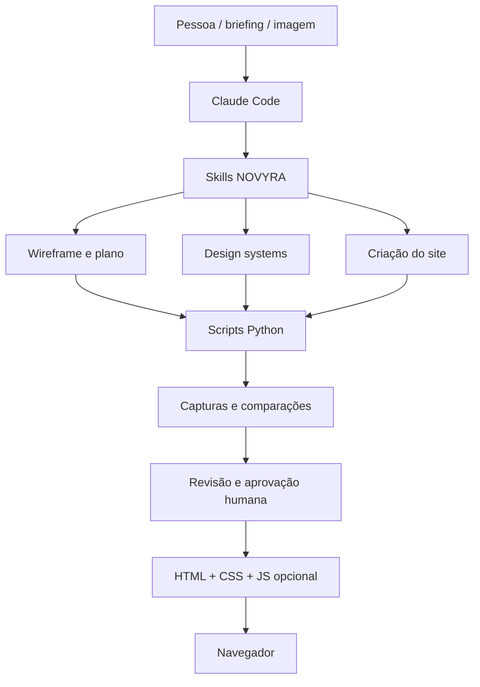
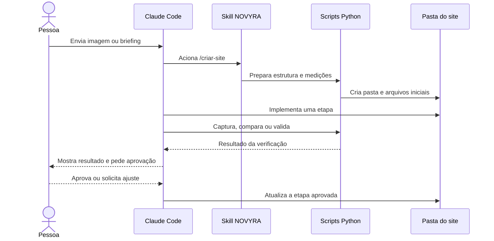

# Arquitetura da NOVYRA

## Visão geral

A NOVYRA não é, nesta versão, um modelo de IA treinado do zero nem um aplicativo web independente. O pacote documentado funciona como um conjunto de skills, scripts, templates e instruções que orientam o Claude Code durante a criação de interfaces.

A IA interpreta o pedido e conduz o processo. Os scripts apoiam tarefas que podem ser medidas ou verificadas, como recorte, amostragem de cores, captura de tela, comparação de imagens e validação de arquivos.

## Diagrama de componentes

## Camadas do projeto

### 1. Skills

As skills descrevem o papel da IA, os passos de trabalho, os critérios de qualidade e os pontos em que ela deve parar para pedir aprovação.

- `criar-site`: coordena o processo de criação.
- `wireframe`: descreve a estrutura da tela.
- `extrair-ds`: organiza a identidade visual de uma referência.
- `combinar-ds`: recombina características de design systems.
- `expert-asimov`: define o comportamento do especialista e aponta para uma base complementar de conhecimento.

### 2. Scripts

Os scripts executam tarefas auxiliares e repetíveis. Eles não substituem a decisão visual nem a aprovação humana.

### 3. Templates

O template `site-base` fornece uma estrutura inicial para cada novo site, evitando começar com uma pasta vazia.

### 4. Sites gerados

Cada site pode ser organizado em uma pasta própria, com HTML, CSS, assets, referência, wireframe e registro de estado. O conteúdo criado pode conter dados ou materiais de terceiros; por isso, a publicação de cada site deve ser decidida separadamente.

### 5. Design systems

Um design system extraído ou combinado reúne tokens, componentes e regras que podem ser reutilizados em novos projetos.

## Fluxo de dados

## Aprendizado e base de conhecimento: situação desta publicação

A skill `expert-asimov` descreve um ciclo de consulta e registro de aprendizados, com distinção entre conteúdo de fontes, correções do usuário, preferências e experiências do próprio expert. O pacote publicado inclui a pasta complementar `01_pesquisa`, com índice temático, sínteses, resumos de vídeos e caderno de aprendizados.

Por esse motivo, a base de conhecimento e o ciclo de aprendizado não devem ser considerados instalados e validados nesta publicação. A integração precisa ser incluída e testada em uma atualização específica.

Também é importante diferenciar memória e aprendizado adaptativo de treinamento de machine learning: os arquivos analisados descrevem registro e recuperação de aprendizados, não evidência de treinamento de pesos de um modelo.

## Integrações externas

A geração de imagens pode usar OpenRouter, mediante chave de API. Essa integração é opcional e pode gerar custos. O processo documentado pede confirmação antes do envio de imagens e prompts.

## Decisões técnicas

- Saída de site: HTML e CSS, com JavaScript opcional.
- Sem framework ou etapa de build por padrão.
- CSS separado em `assets/styles.css`.
- Caminhos relativos para recursos locais.
- Tokens visuais organizados como custom properties CSS.
- Scripts auxiliares em Python.
- Claude Code como ambiente de execução das skills.

## Limites

A arquitetura é experimental. A documentação descreve o comportamento pretendido pelas skills; o funcionamento real depende da versão do Claude Code, do ambiente local, das dependências e dos testes de cada fluxo.
