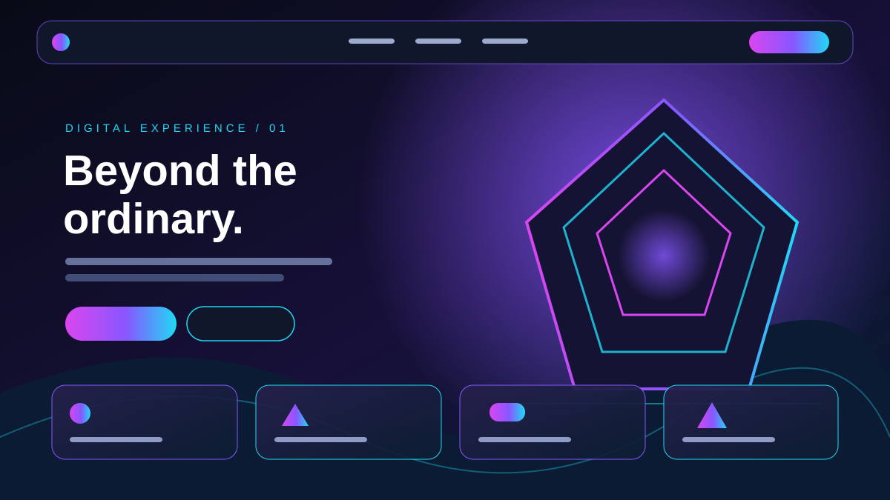
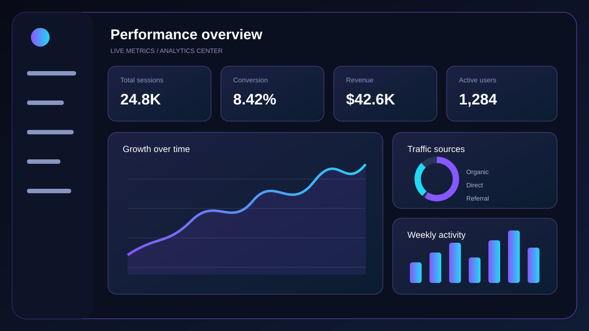
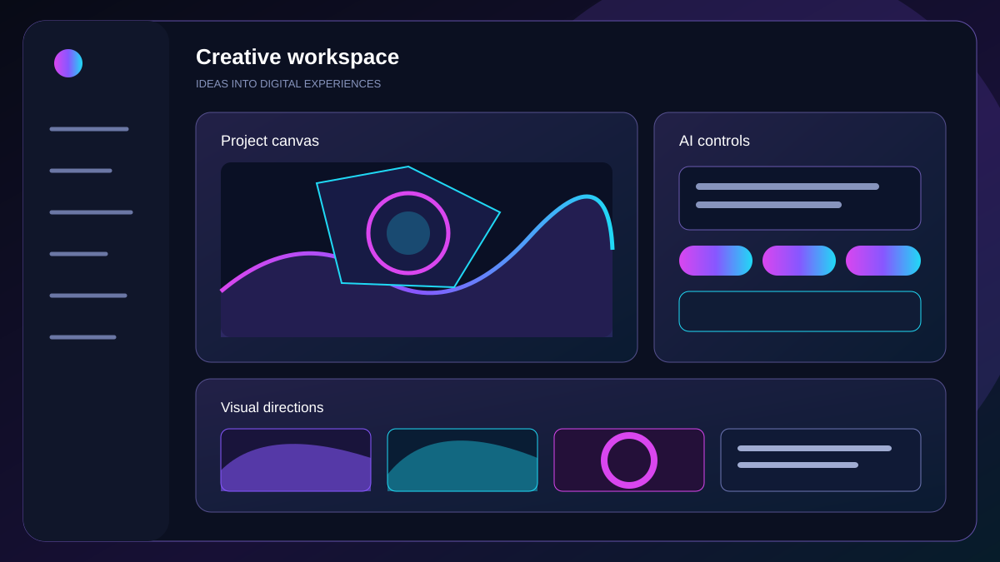

# Galeria de exemplos visuais

Esta galeria apresenta três conceitos visuais criados para ilustrar o tipo de experiência digital que a NOVYRA pretende ajudar a desenvolver.

**Importante:** as imagens são ilustrações conceituais. Não são screenshots de sites produzidos pela ferramenta, nem comprovam que cada detalhe visual ou interação já foi implementado e testado. Servem como referências de direção criativa.

## 1. Landing page futurista



**Ideia:** página institucional ou de produto com hero de grande impacto, portal dimensional, fundos atmosféricos, cartões translúcidos e chamadas de ação.

**Possíveis aplicações:** lançamento de produto, apresentação de startup, portfólio, campanha digital e página de evento.

## 2. Dashboard de analytics



**Ideia:** painel com cartões de KPI, gráficos, indicadores e visualizações de dados em uma interface dark futurista.

**Possíveis aplicações:** monitoramento de operações, métricas de marketing, acompanhamento de projetos e painéis executivos.

## 3. Estúdio criativo



**Ideia:** ambiente visual para organizar referências, explorar conceitos, apresentar projetos e acompanhar uma criação.

**Possíveis aplicações:** portfólio de design, galeria de projetos, catálogo visual e interface de ferramenta criativa.

## Como usar estas referências

1. Escolha o conceito que mais se aproxima do resultado desejado.
2. Use a imagem como referência visual ou descreva a ideia em um briefing.
3. Execute a skill `/criar-site` no ambiente Claude Code.
4. Revise o wireframe, as etapas de construção e o resultado responsivo.
5. Compare o site produzido com a referência e solicite ajustes quando necessário.

Exemplo de briefing:

```text
/criar-site brief="Landing futurista para uma plataforma de IA, com hero imersivo, cards translúcidos, paleta violeta e ciano e layout responsivo" slug=landing-novyra
```

Os resultados reais dependem do briefing, da referência, do ambiente de execução e das revisões realizadas.
