<div align="center">

# NOVYRA

### Create Beyond Limits.

**Creative Intelligence Platform** · image or idea → design system → HTML + CSS website

Skills for **Claude Code** and **Codex** that turn a screenshot, a mockup or a text brief into a faithful website, in **5 stages with your approval**, measuring every layer against the reference.

[](https://github.com/carlos-dataengineer/novyra/actions/workflows/ci.yml)


[Português](README.md) · **English**

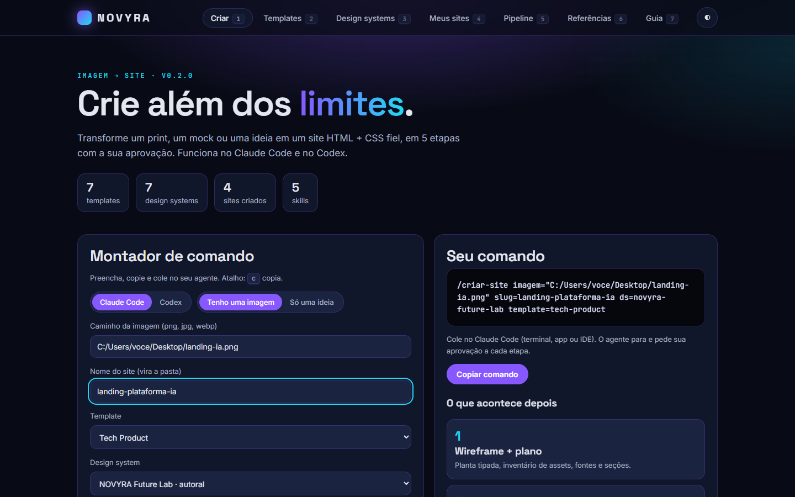

</div>

> The tool's interface and skill names are in Portuguese (`criar-site` = *create site*). They work in any language: talk to the agent in English and it answers in English.

---

## Contents

- [What it is](#what-it-is)
- [Install (one command)](#install)
- [What the install generates: NOVYRA Studio](#what-the-install-generates-novyra-studio)
- [How to use](#how-to-use)
- [The 5 stages](#the-5-stages)
- [Skills and parameters](#skills-and-parameters)
- [Templates and design systems](#templates-and-design-systems)
- [Use cases](#use-cases)
- [Shortcuts](#shortcuts)
- [Measurement scripts](#measurement-scripts)
- [Requirements](#requirements)
- [FAQ](#faq)
- [Update and uninstall](#update-and-uninstall)

## What it is

Asking an AI to "recreate this screen" usually gets you something similar, not the same: wrong background, swapped fonts, guessed spacing. NOVYRA splits the work into **layers you approve one by one**, and **measures** each layer with scripts (color picker, coordinate grid, Chrome capture and pixel comparison).

| You provide | NOVYRA delivers |
|---|---|
| A screenshot, mockup or photo of a screen (png, jpg, webp) **or** a text description | A folder with `index.html` + `assets/styles.css`, no framework, no build step |
| Your "approved" (`aprovado`) or a change request at the end of each stage | A capture, side-by-side comparison and similarity score at every stage |
| Optional: a public reference URL | A **design system** with tokens, components and a live catalog, reusable across sites |

**Works the same in Claude Code and Codex.** In Claude use `/criar-site`; in Codex use `$criar-site`.

NOVYRA has three layers, all running on your machine:

| Layer | What it is |
|---|---|
| **A. Repertoire** | 7 futuristic models, a catalog of 8 real references (Lusion and DesignRush), design systems with a live catalog, and design system extraction from any public site |
| **B. Interface** | **NOVYRA Studio**, the dashboard generated at install time |
| **C. Engine** | **Claude Code** or **Codex**: they read the image, plan, build and run the real measurement and validation scripts |

## Install

**macOS, Linux, WSL or Git Bash:**

```bash
curl -fsSL https://raw.githubusercontent.com/carlos-dataengineer/novyra/main/install.sh | bash
```

**Windows (PowerShell):**

```powershell
irm https://raw.githubusercontent.com/carlos-dataengineer/novyra/main/install.ps1 | iex
```

That's it. The installer:

1. Copies the runtime (scripts, templates and design systems) to `~/Novyra`.
2. Installs the Python dependencies (Pillow and Playwright; Playwright uses the Chrome you already have).
3. Installs the 5 skills into **Claude Code** (`~/.claude/skills`) and **Codex** (`~/.codex/skills` and `~/.agents/skills`).
4. **Automatically generates the tool, NOVYRA Studio, and opens it in your browser.**

Then start a **new conversation** in Claude Code or Codex so the skills show up.

<details>
<summary><b>Other ways to install and options</b></summary>

**From a clone:**

```bash
git clone https://github.com/carlos-dataengineer/novyra.git
cd novyra
bash install.sh            # Windows: .\install.ps1
```

**As a Claude Code plugin** (skills only; run the installer above to get the runtime):

```text
/plugin marketplace add carlos-dataengineer/novyra
/plugin install novyra@novyra
```

**Options** (environment variables, both installers):

| Variable | Effect |
|---|---|
| `NOVYRA_HOME=D:/Novyra` | another folder for runtime and sites (default `~/Novyra`) |
| `NOVYRA_NO_OPEN=1` | don't open the browser at the end |
| `NOVYRA_SKIP_CLAUDE=1` / `NOVYRA_SKIP_CODEX=1` | install into only one agent |
| `NOVYRA_SKIP_DEPS=1` | skip `pip install` |
| `NOVYRA_REF=v0.2.0` | install a tagged version |

</details>

## What the install generates: NOVYRA Studio

When it finishes, the installer **generates and opens** `~/Novyra/novyra.html`, the tool's dashboard. No commands to memorize.

| Tab | Purpose |
|---|---|
| **Criar** (Create) | Command builder: pick image or idea, name, template and design system; copy the command for Claude Code or Codex |
| **Templates** | Live previews of the starting points |
| **Design systems** | Colors, fonts and catalog of each design system |
| **Meus sites** (My sites) | Every site you created, with progress through the 5 stages and the command to resume |
| **Pipeline** | A site's 5 stages as agents in neon cards linked by light flows: status, progress, real artifacts and scripts |
| **Referências** (References) | 8 real futuristic sites with the matching NOVYRA model |
| **Guia** (Guide) | Stages, skills, shortcuts and scripts |

Reopen and refresh it any time: **`/novyra`** in Claude Code (in the Claude app it opens as an **artifact**), **`$novyra`** in Codex, or open `~/Novyra/novyra.html` in a browser.

### Agent pipeline

Each `/criar-site` stage shows up as an **agent**: Blueprint, Atmosphere, Interface, Assets and Review. Neon cards are linked by light flows, and particles run only up to the stage in progress. Status comes from the site's `ESTADO.md`; checked items (✓) come from **files that actually exist** in the site folder (wireframe, captures, comparison, crops). Nothing is made up.

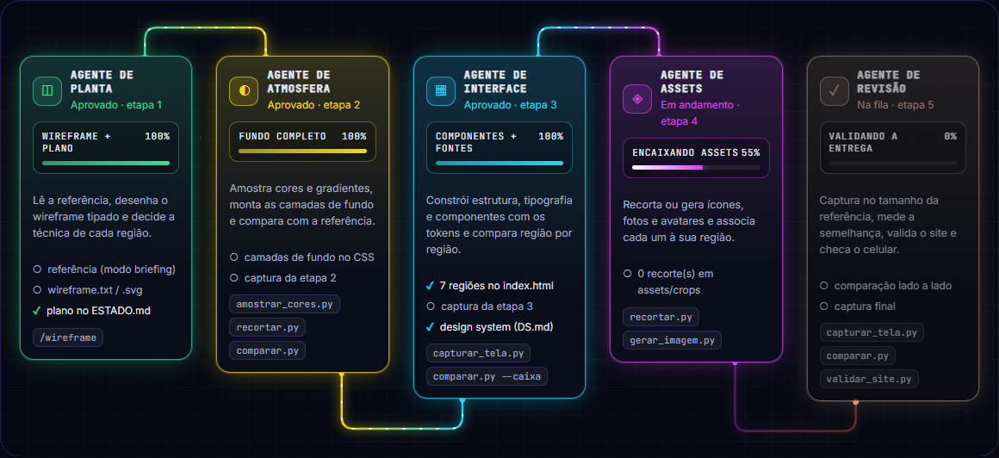

<table>
<tr>
<td width="50%">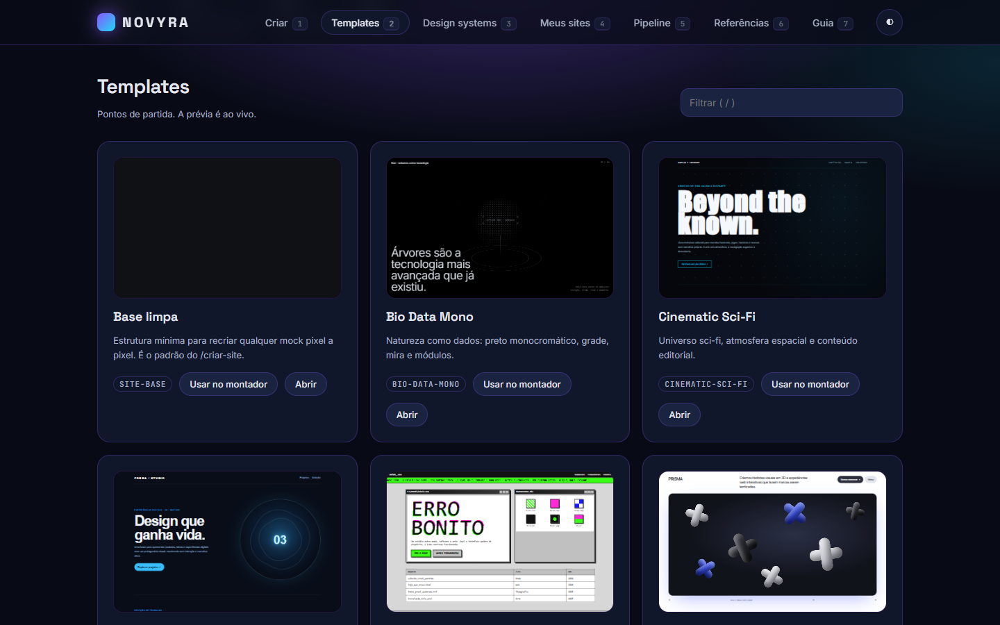<br><sub><b>Templates</b>: live previews; one click sends a template to the builder.</sub></td>
<td width="50%">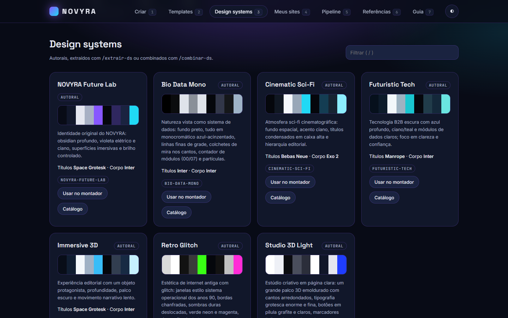<br><sub><b>Design systems</b>: colors, fonts and catalog.</sub></td>
</tr>
<tr>
<td width="50%">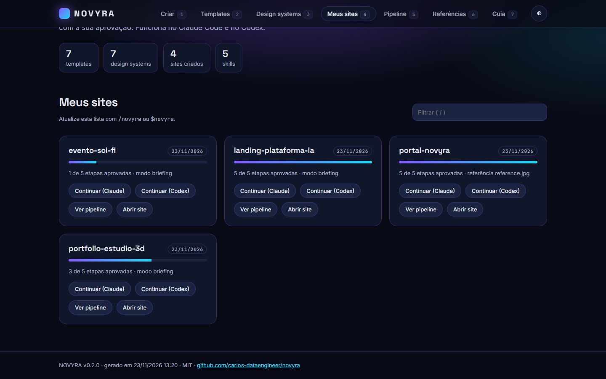<br><sub><b>My sites</b>: stage progress and the resume command.</sub></td>
<td width="50%">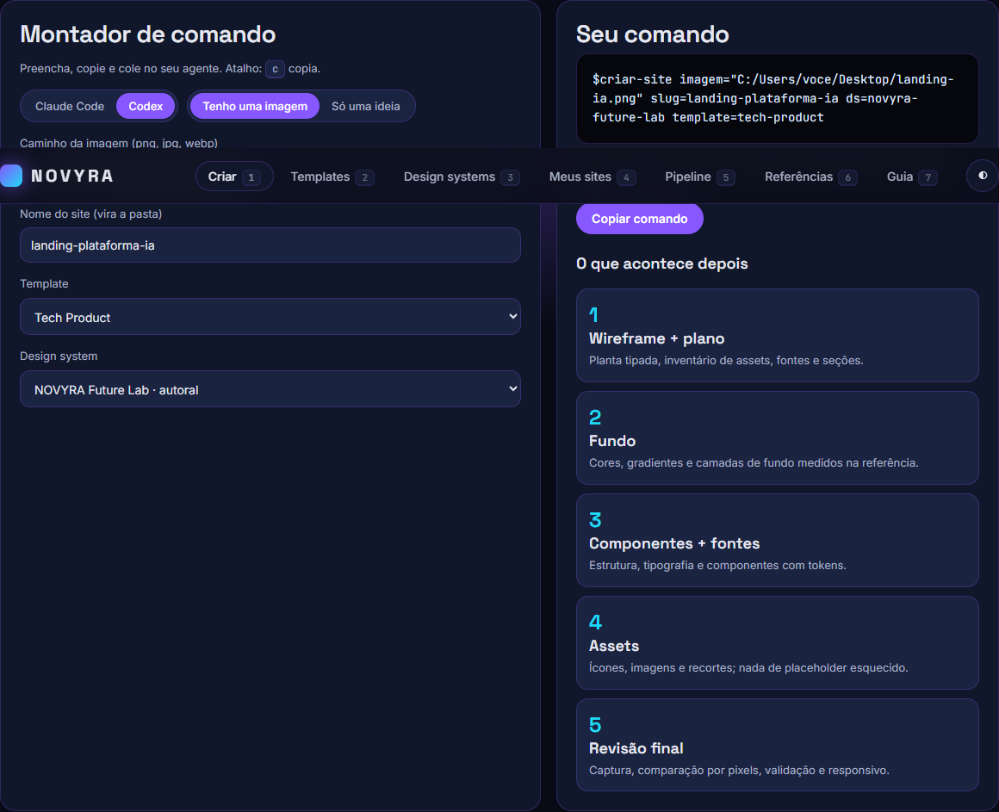<br><sub><b>Codex</b>: the same builder outputs <code>$criar-site</code>.</sub></td>
</tr>
</table>

## How to use

**From an image:**

```text
/criar-site imagem="C:/Users/you/Desktop/screen.png" slug=my-landing
```

Codex: `$criar-site imagem="..." slug=my-landing`. The agent creates `~/Novyra/sites/my-landing/`, draws the wireframe and **stops**, waiting for you. Reply `aprovado` (approved) to continue, or ask for a change.

**From an idea:**

```text
/criar-site brief="Landing page for an AI platform with an immersive hero, 3 features and a CTA" slug=ai-platform ds=novyra-future-lab template=tech-product
```

**With a design system extracted from a public site:**

```text
/extrair-ds url=https://example.com slug=reference
/criar-site imagem="C:/mocks/screen.png" slug=my-site ds=reference
```

**Resume later:** `/criar-site slug=my-landing` (the agent reads the site's `ESTADO.md`).

## Demo: from an artwork to a landing page

Input: a vertical artwork (736×1308), in NOVYRA's "portal to the unknown" direction. Command:

```text
/criar-site imagem="vortex.jpg" slug=portal-novyra ds=novyra-future-lab brief="NOVYRA landing: the art is the hero background; method, layers and models sections"
```

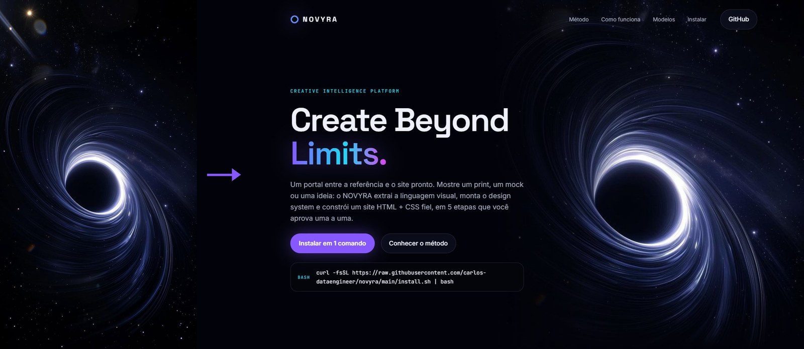

| Stage | What happened |
|---|---|
| 1. Wireframe + plan | The art is not a UI screen, so the plan used it as the **hero background** and drew the interface on top ([wireframe.txt](examples/portal-novyra/wireframe.txt)). |
| 2. Background | Palette measured from the art with `amostrar_cores.py`: background `#010103`, indigo `#2d355d`/`#434b7a`/`#7b81af`, ring `#fbfbf8`. Background vs reference: **100%**. |
| 3. Components + fonts | Nav, "Create Beyond Limits" hero, 5-stage method, A/B/C layers, 4 models and install. NOVYRA identity (violet `#8757FF`, cyan `#20D9F5`, magenta `#D946EF`), Space Grotesk + Inter. No horizontal overflow at 390 px. |
| 4. Assets | Skipped: no icons or photos besides the art. |
| 5. Review | At reference size: **91.4%** full page (hero text covers part of the art) and **100%** in the art region; `validar_site.py` OK. |

<table>
<tr>
<td width="62%">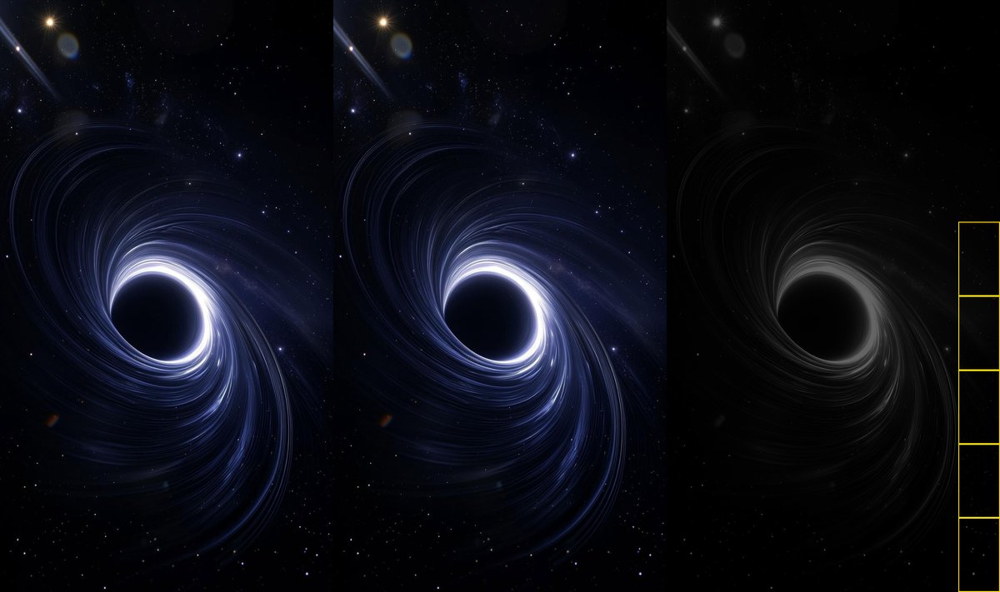<br><sub><b>Stage 2</b>: reference | site | diff map.</sub></td>
<td width="38%" align="center">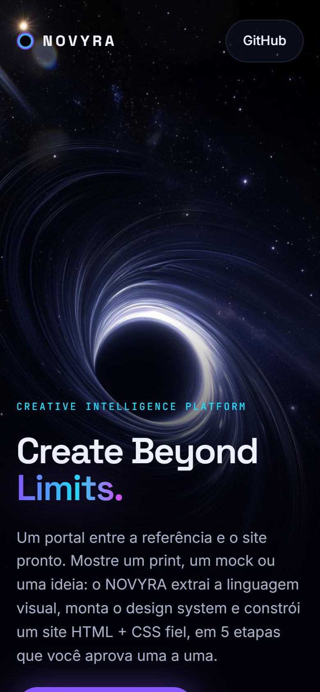<br><sub><b>Phone</b>: the art sits behind the hero.</sub></td>
</tr>
</table>

The site lives in [`examples/portal-novyra`](examples/portal-novyra): open `index.html` in a browser.

## The 5 stages

| # | Stage | What the agent does | What you approve |
|---|---|---|---|
| 1 | **Wireframe + plan** | Typed blueprint of the screen (each region becomes a CSS class) and the technique for each part | Is the structure right? |
| 2 | **Background** | Colors, gradients and glows measured with the color picker and grid | Does the background match? |
| 3 | **Components + fonts** | Structure, typography, cards, buttons; compared region by region | Text, fonts and spacing |
| 4 | **Assets** | Icons, photos and avatars (crops or SVG); skipped if none | Visual details |
| 5 | **Final review** | Capture at reference size, comparison, similarity score and validation | The finished site |

Nothing moves forward without your approval. Everything is logged in the site's `ESTADO.md`.

## Skills and parameters

| Claude Code | Codex | What it does | Parameters |
|---|---|---|---|
| `/criar-site` | `$criar-site` | Image or brief → website in 5 stages | `imagem` (image), `brief`, `slug`, `ds`, `template` |
| `/wireframe` | `$wireframe` | Typed blueprint in ASCII or SVG (stage 1) | `formato=ascii\|svg`, `imagem`, `brief`, `saida` (output) |
| `/extrair-ds` | `$extrair-ds` | Design system from a public URL: tokens, components, catalog | `url`, `slug` |
| `/combinar-ds` | `$combinar-ds` | New design system from parts of others | `nome` (name), `base`, `cores`, `tipografia`, `formas`, `movimento`, `fundos` |
| `/novyra` | `$novyra` | Refreshes and opens NOVYRA Studio | — |

Skills that change files only run when **you** call them.

## Templates and design systems

| | | |
|---|---|---|
| 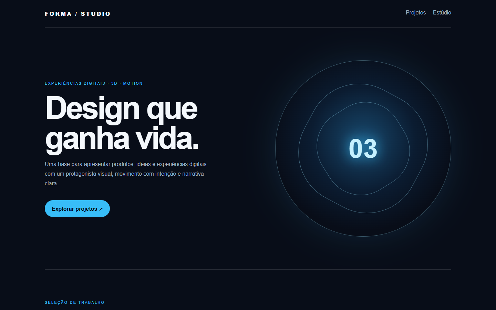 | 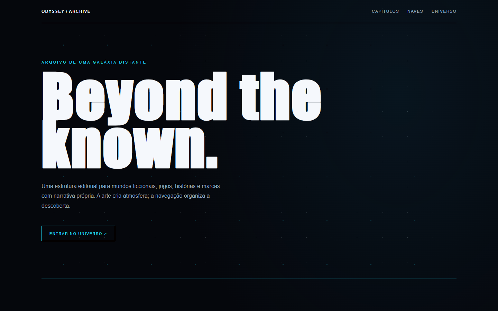 | 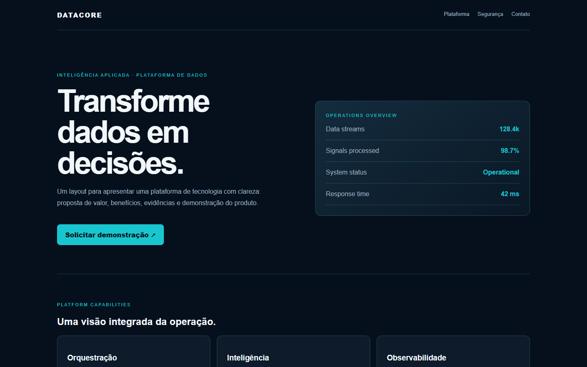 |
| `immersive-3d-studio` | `cinematic-sci-fi` | `tech-product` |
| 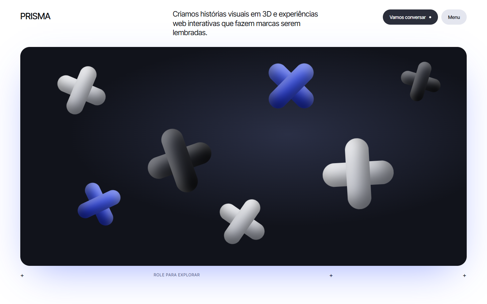 | 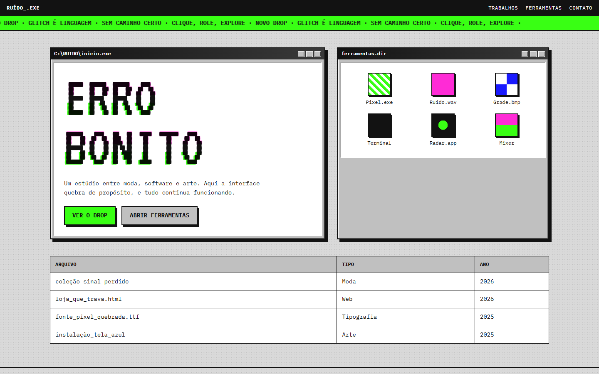 | 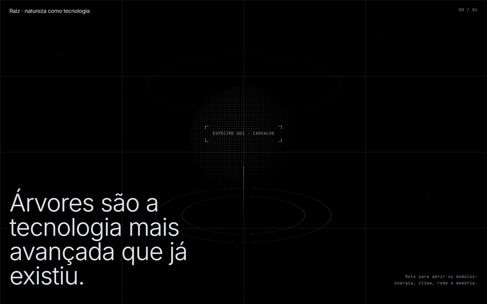 |
| `studio-3d-light` | `retro-glitch` | `bio-data-mono` |

Plus `site-base`, the clean default for pixel-perfect recreation.

| Design system | Direction | Inspired by | Fonts |
|---|---|---|---|
| `novyra-future-lab` | Obsidian, electric violet, cyan and magenta | NOVYRA identity | Space Grotesk / Inter |
| `studio-3d-light` | Light page, framed 3D stage, graphite pills | Lusion | Inter Tight |
| `cinematic-sci-fi` | Space cyan, condensed uppercase headings | Takamo Universe | Bebas Neue / Exo 2 |
| `futuristic-tech` | Deep blue and teal, data modules | DataBahn, Moulds & More | Manrope / Inter |
| `bio-data-mono` | Monochrome black, grid, crosshairs, modules | Nature Beyond Technology | Inter / JetBrains Mono |
| `retro-glitch` | Old-OS windows, neon green, magenta, hard shadows | GLIX Studio | VT323 / IBM Plex Mono |
| `immersive-3d` | Hero object on a dark stage | Bear Classes, Alex Gurghis | Space Grotesk / Inter |

### Futuristic references

NOVYRA ships a catalog of **8 real references**: [Lusion](https://lusion.co/) and the 7 designs in the [DesignRush Futuristic](https://www.designrush.com/best-designs/websites/futuristic) gallery, each with the observed visual patterns and the matching NOVYRA model. The **Referências** tab in NOVYRA Studio gives every card three buttons: copy `/extrair-ds` to measure the site, build a site in that direction, or use the model.

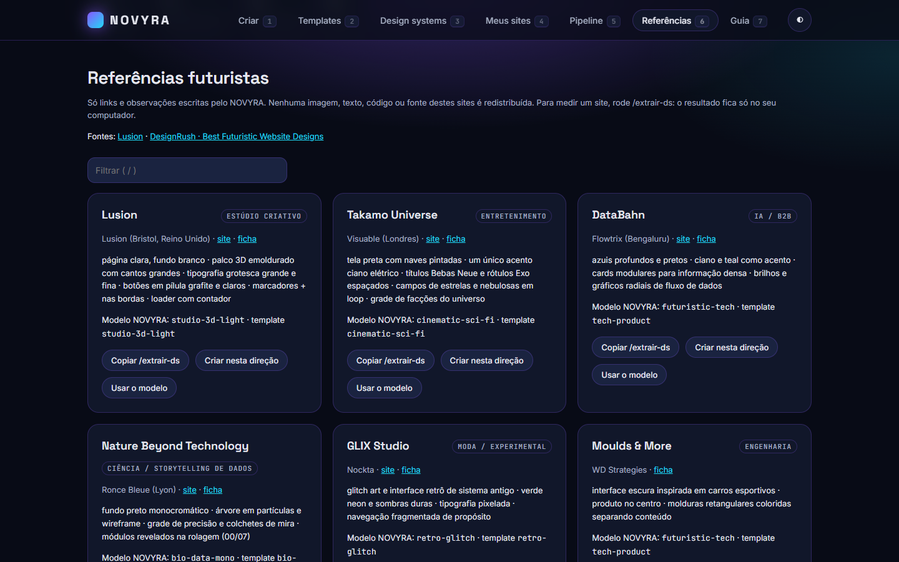

The catalog holds only links and NOVYRA's own notes; no images, copy or code from those sites. `/extrair-ds` runs and keeps its output **on your machine**.

Each design system ships a **live catalog** (`design-system.html`) with colors and contrast, type scale, shapes, motion and components in default, hover, focus and disabled states:

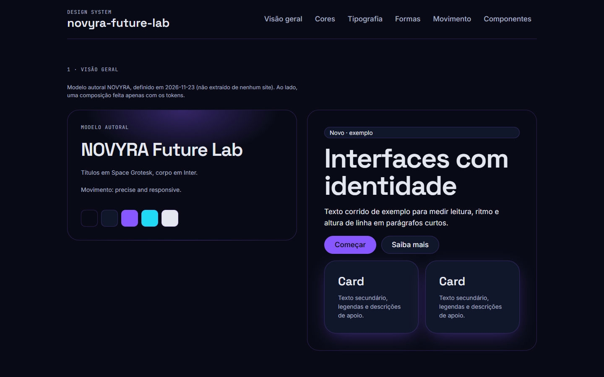

## Use cases

| Situation | Command |
|---|---|
| Rebuild a Figma mock exported as PNG | `/criar-site imagem="mock.png" slug=app-login` |
| Turn a photo of a paper sketch into a landing page | `/criar-site imagem="photo.jpg" slug=event` |
| Product landing page from an idea only | `/criar-site brief="..." slug=product ds=futuristic-tech` |
| Keep several sites on one identity | `/extrair-ds` once, then `ds=` on each `/criar-site` |
| Mix references (colors from one, type from another) | `/combinar-ds nome=brand base=a cores=b tipografia=c` |
| Check an implementation against the design | `capturar_tela.py` + `comparar.py` (similarity score) |

## Shortcuts

**In NOVYRA Studio:** <kbd>1</kbd>–<kbd>7</kbd> switch tabs · <kbd>c</kbd> copy the command · <kbd>a</kbd> toggle Claude Code / Codex · <kbd>/</kbd> focus filter · <kbd>t</kbd> light/dark theme · <kbd>?</kbd> show shortcuts · <kbd>Esc</kbd> leave a text field.

**While building (in the chat):**

| You type | Effect |
|---|---|
| `aprovado` (approved) | Unlocks the next stage |
| `fix the hero: the title is bigger` | Fixes the current stage |
| `go back to stage 2` | Redo from a stage |
| `/criar-site slug=my-site` | Resume a site |

## Measurement scripts

Skills run them for you; you can also run them in `~/Novyra/scripts` with `python -X utf8`:

| Script | Purpose |
|---|---|
| `novo_site.py` | Creates `sites/<slug>` from a template (`--imagem`, `--ds`, `--template`) |
| `recortar.py` | Coordinate grid, crops and zoom of the reference |
| `amostrar_cores.py` | Exact color of points, palette and gradient of a region |
| `capturar_tela.py` | Headless Chrome capture at the reference size |
| `comparar.py` | Side by side, diff map and similarity score |
| `validar_site.py` | Missing assets, paths, inline CSS/JS, CDNs |
| `capturar_site.py` · `extrair_tokens.py` · `gerar_ds_html.py` | Design system extraction |
| `combinar_ds.py` | Design system combination |
| `gerar_painel.py` | Generates NOVYRA Studio |
| `gerar_imagem.py` | Optional, paid: icons and images via OpenRouter (key in `.env`) |

Score: **≥ 95%** practically identical · **85–95%** good, detail differences · **< 85%** check the worst regions and the diff map.

## Requirements

- **Claude Code** and/or **Codex** (CLI, app or IDE extension).
- **Python 3.10+** (on Windows tick *Add python.exe to PATH*).
- **Google Chrome** (or Edge) for captures and design system extraction.
- Windows, macOS or Linux.

Everything runs locally: no account, no telemetry. Only `gerar_imagem.py` calls an external service, and only if you set a key.

## FAQ

<details><summary><b>The skill doesn't show up after installing.</b></summary>

Start a new conversation; agents load skills when a session starts. In Claude Code type `/` and look for `criar-site`; in Codex type `$`.
</details>

<details><summary><b>Can I use the generated site in production?</b></summary>

Yes, it's plain HTML + CSS. Deploy to any static host. Remove `reference.*` and `_capturas/` first if the reference is confidential, and check licenses of images and fonts taken from the reference.
</details>

<details><summary><b>Can I extract the design system of any site?</b></summary>

Public pages without login only. NOVYRA does not bypass captchas or blocks. Use extracted systems to learn and reuse **rules** (colors, type scale, radii); don't copy third-party brands, copy or images. The `fonte/` folder with screenshots stays on your machine.
</details>

<details><summary><b>Where are my sites? What happens if I reinstall?</b></summary>

In `~/Novyra/sites/<slug>/` (or `NOVYRA_SITES`). Reinstalling only replaces the packaged scripts, templates and design systems; your sites and your own design systems stay.
</details>

## Update and uninstall

**Update:** run the install command again.

**Uninstall** (removes skills and runtime; keeps `~/Novyra/sites`):

```bash
curl -fsSL https://raw.githubusercontent.com/carlos-dataengineer/novyra/main/uninstall.sh | bash
```

```powershell
irm https://raw.githubusercontent.com/carlos-dataengineer/novyra/main/uninstall.ps1 | iex
```

## Docs, contributing and license

Docs (Portuguese): [usage guide](docs/guia-de-uso.md) · [methodology](docs/metodologia.md) · [architecture](docs/arquitetura.md) · [use cases](docs/casos-de-uso.md) · [roadmap](docs/roadmap.md).

Credits: NOVYRA's method grew out of research on **Asimov Academy**'s public content (Vibe Design and the AI Designer course). **Lusion** and the **DesignRush** galleries were visual repertoire only; nothing was copied. See [NOTICE](NOTICE).

Contributing: [CONTRIBUTING.md](CONTRIBUTING.md) · Security: [SECURITY.md](SECURITY.md) · License: [MIT](LICENSE) · Credits: [NOTICE](NOTICE) · [Changelog](CHANGELOG.md).

<div align="center"><sub>NOVYRA · Create Beyond Limits.</sub></div>
