<div align="center">

# NOVYRA

### Create Beyond Limits.

**Creative Intelligence Platform** · imagem ou ideia → design system → site HTML + CSS

Skills para **Claude Code** e **Codex** que transformam um print, um mock ou uma descrição em um site fiel, em **5 etapas com a sua aprovação**, medindo cada camada contra a referência.

[](https://github.com/carlos-dataengineer/novyra/actions/workflows/ci.yml)


**Português** · [English](README.en.md)

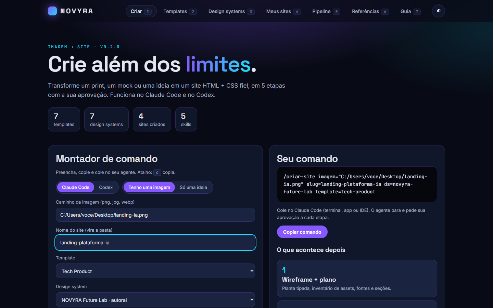

</div>

---

## Sumário

- [O que é](#o-que-é)
- [Instalação (um comando)](#instalação)
- [O que a instalação gera: o NOVYRA Studio](#o-que-a-instalação-gera-o-novyra-studio)
- [Como usar](#como-usar)
- [As 5 etapas](#as-5-etapas)
- [Skills e parâmetros](#skills-e-parâmetros)
- [Templates e design systems](#templates-e-design-systems)
- [Casos de uso](#casos-de-uso)
- [Atalhos](#atalhos)
- [Scripts de medição](#scripts-de-medição)
- [Requisitos](#requisitos)
- [Perguntas frequentes](#perguntas-frequentes)
- [Atualizar e desinstalar](#atualizar-e-desinstalar)
- [Documentação, contribuição e licença](#documentação)

## O que é

Pedir "recria essa tela" para uma IA costuma dar um resultado parecido, mas não igual: fundo errado, fontes trocadas, espaçamentos chutados. O NOVYRA resolve isso dividindo o trabalho em **camadas que você aprova uma a uma**, e **medindo** cada camada com scripts (conta-gotas, grade de coordenadas, captura no Chrome e comparação por pixels).

| Você entrega | O NOVYRA entrega |
|---|---|
| Um print, mock ou foto de tela (png, jpg, webp) **ou** uma descrição em texto | Uma pasta com `index.html` + `assets/styles.css`, sem framework e sem build, que abre com dois cliques |
| Seu "aprovado" (ou um ajuste) ao fim de cada etapa | Captura, comparação lado a lado e nota de semelhança a cada etapa |
| Opcional: uma URL pública de referência | Um **design system** com tokens, componentes e catálogo vivo, reutilizável em outros sites |

**Funciona igual no Claude Code e no Codex.** No Claude use `/criar-site`; no Codex use `$criar-site`.

O NOVYRA tem três camadas, e todas rodam no seu computador:

| Camada | O que é |
|---|---|
| **A. Repertório** | 7 modelos futuristas, catálogo de 8 referências reais (Lusion e DesignRush), design systems com catálogo vivo e extração de design system de qualquer site público |
| **B. Interface** | O **NOVYRA Studio**, painel gerado na instalação |
| **C. Motor** | O **Claude Code** ou o **Codex**: analisam a imagem, planejam, constroem e rodam os scripts reais de medição e validação |

## Instalação

**macOS, Linux, WSL ou Git Bash:**

```bash
curl -fsSL https://raw.githubusercontent.com/carlos-dataengineer/novyra/main/install.sh | bash
```

**Windows (PowerShell):**

```powershell
irm https://raw.githubusercontent.com/carlos-dataengineer/novyra/main/install.ps1 | iex
```

Pronto. O instalador faz quatro coisas:

1. Copia o runtime (scripts, templates e design systems) para `~/Novyra`.
2. Instala as dependências Python (Pillow e Playwright; o Playwright usa o Chrome que você já tem).
3. Instala as 5 skills no **Claude Code** (`~/.claude/skills`) e no **Codex** (`~/.codex/skills` e `~/.agents/skills`).
4. **Gera automaticamente a ferramenta, o NOVYRA Studio, e abre no navegador.**

Depois, abra uma **conversa nova** no Claude Code ou no Codex para as skills aparecerem.

<details>
<summary><b>Outras formas de instalar e opções</b></summary>

**A partir do clone:**

```bash
git clone https://github.com/carlos-dataengineer/novyra.git
cd novyra
bash install.sh            # Windows: .\install.ps1
```

**Como plugin do Claude Code** (só as skills; rode o instalador acima para ter o runtime):

```text
/plugin marketplace add carlos-dataengineer/novyra
/plugin install novyra@novyra
```

**Opções** (variáveis de ambiente, valem nos dois instaladores):

| Variável | Efeito |
|---|---|
| `NOVYRA_HOME=D:/Novyra` | outra pasta para runtime e sites (padrão `~/Novyra`) |
| `NOVYRA_NO_OPEN=1` | não abre o navegador no fim |
| `NOVYRA_SKIP_CLAUDE=1` / `NOVYRA_SKIP_CODEX=1` | instala só em um dos agentes |
| `NOVYRA_SKIP_DEPS=1` | não roda o `pip install` |
| `NOVYRA_REF=v0.2.0` | instala uma versão marcada |

Exemplo no PowerShell: `$env:NOVYRA_SKIP_CODEX = "1"; irm https://raw.githubusercontent.com/carlos-dataengineer/novyra/main/install.ps1 | iex`

</details>

## O que a instalação gera: o NOVYRA Studio

Ao terminar, o instalador **gera e abre** o `~/Novyra/novyra.html`: o painel da ferramenta. Você não precisa decorar nenhum comando.

| Aba | Para quê |
|---|---|
| **Criar** | Montador de comando: escolha imagem ou ideia, nome, template e design system; copie o comando para Claude Code ou Codex |
| **Templates** | Prévia ao vivo dos pontos de partida |
| **Design systems** | Cores, fontes e catálogo de cada design system |
| **Meus sites** | Todos os sites criados, com o progresso das 5 etapas e o comando para continuar |
| **Pipeline** | As 5 etapas de um site como agentes em cards neon ligados por fluxos de luz: status, progresso, artefatos reais e scripts de cada um |
| **Referências** | 8 sites futuristas reais com o modelo NOVYRA de cada um |
| **Guia** | Etapas, skills, atalhos e scripts |

Para reabrir e atualizar o painel a qualquer momento: **`/novyra`** no Claude Code (no app do Claude ele abre como **artefato**), **`$novyra`** no Codex, ou abra `~/Novyra/novyra.html` no navegador.

### Pipeline de agentes

Cada etapa do `/criar-site` aparece como um **agente**: Planta, Atmosfera, Interface, Assets e Revisão. Os cards se ligam por fluxos de luz, e as partículas correm só até a etapa em andamento. Os status vêm do `ESTADO.md` do site. Os itens marcados (✓) vêm dos **arquivos que existem de fato** na pasta, como wireframe, capturas, comparação e recortes; nada é inventado. Escolha o site no seletor, ou clique em **Ver pipeline** na aba Meus sites.

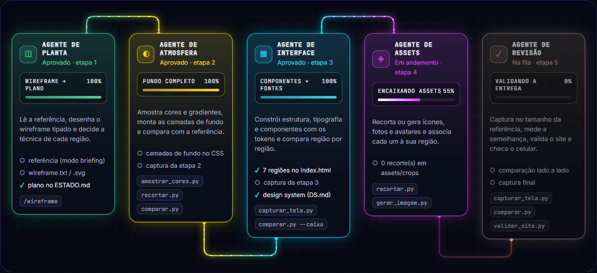

<details><summary><b>Pipeline da demonstração (as 5 etapas concluídas)</b></summary>

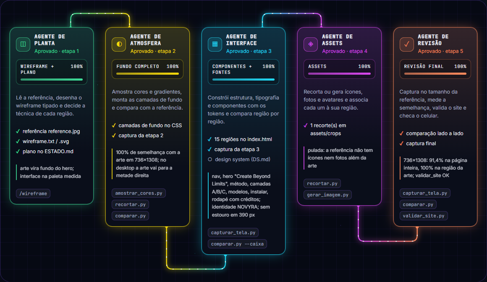

</details>

<table>
<tr>
<td width="50%">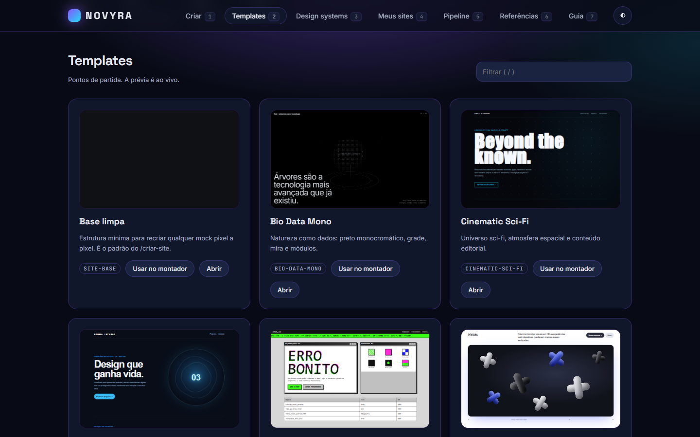<br><sub><b>Templates</b>: prévia ao vivo, um clique leva o template para o montador.</sub></td>
<td width="50%">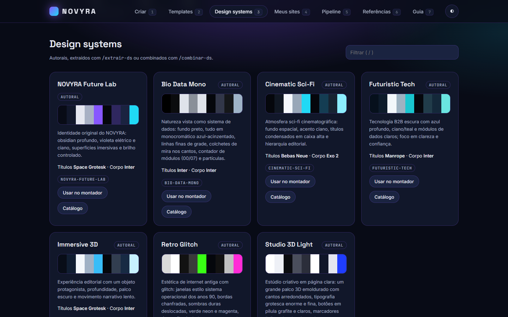<br><sub><b>Design systems</b>: cores, fontes e catálogo de cada um.</sub></td>
</tr>
<tr>
<td width="50%">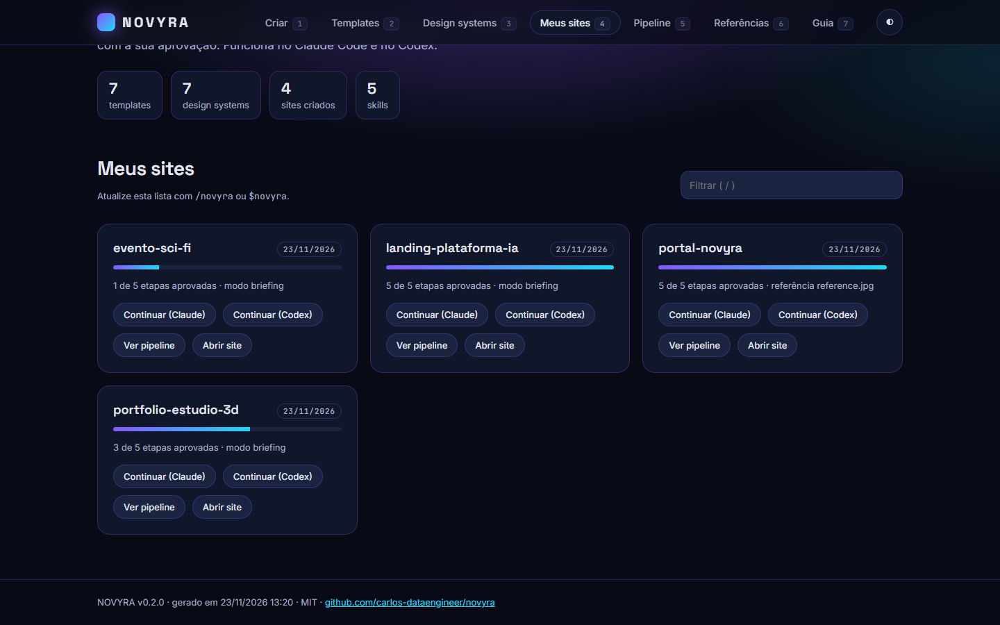<br><sub><b>Meus sites</b>: progresso das etapas e o comando para continuar.</sub></td>
<td width="50%">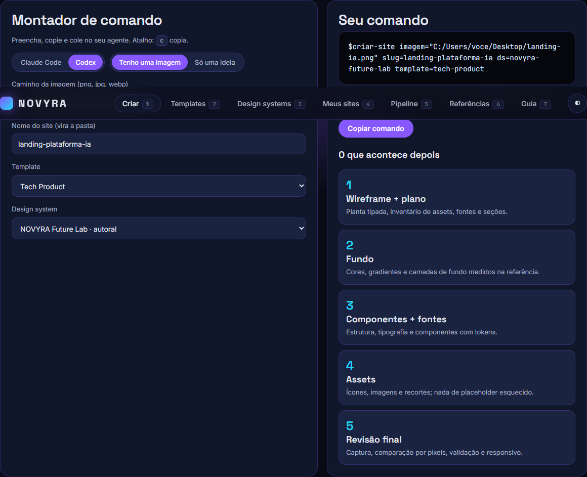<br><sub><b>Codex</b>: o mesmo montador gera <code>$criar-site</code>.</sub></td>
</tr>
<tr>
<td width="50%">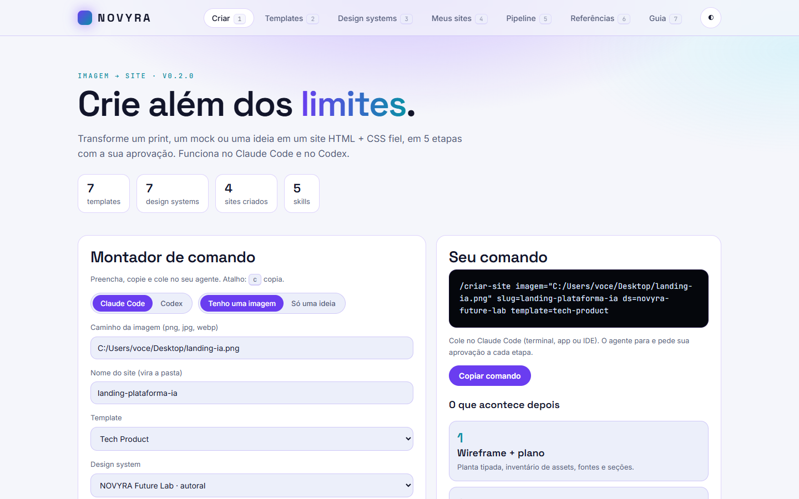<br><sub>Tema claro (<kbd>t</kbd>).</sub></td>
<td width="50%" align="center">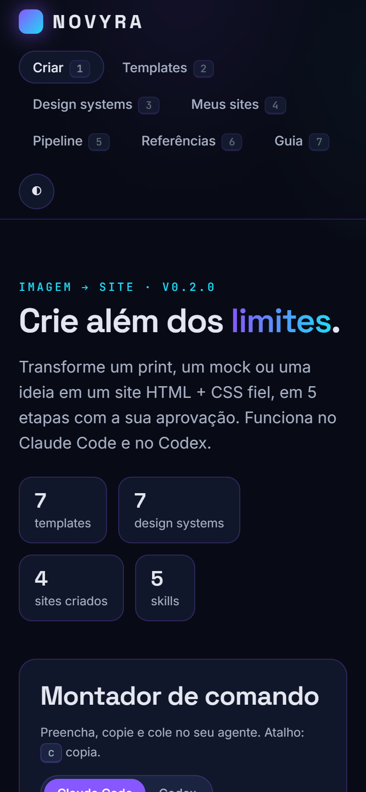<br><sub>Funciona no celular.</sub></td>
</tr>
</table>

## Como usar

### 1. A partir de uma imagem

```text
/criar-site imagem="C:/Users/voce/Desktop/tela.png" slug=minha-landing
```

Codex: `$criar-site imagem="C:/Users/voce/Desktop/tela.png" slug=minha-landing`

O agente cria `~/Novyra/sites/minha-landing/`, faz o wireframe e **para**, esperando você. Responda `aprovado` para seguir ou peça um ajuste ("o card da direita é um gráfico"). Assim até a revisão final.

### 2. A partir de uma ideia

```text
/criar-site brief="Landing de uma plataforma de IA com hero imersivo, 3 recursos e CTA" slug=plataforma-ia ds=novyra-future-lab template=tech-product
```

### 3. Com um design system extraído de um site público

```text
/extrair-ds url=https://exemplo.com slug=referencia
/criar-site imagem="C:/mocks/tela.png" slug=meu-site ds=referencia
```

### 4. Retomar um site depois

```text
/criar-site slug=minha-landing
```

O agente lê o `ESTADO.md` do site e continua da etapa em que parou.

## Demonstração: de uma arte a uma landing page

Entrada: uma arte vertical (736×1308), na direção "portal para o desconhecido" da identidade NOVYRA. Comando:

```text
/criar-site imagem="vortex.jpg" slug=portal-novyra ds=novyra-future-lab brief="Landing do NOVYRA: a arte é o fundo do hero; seções de método, camadas e modelos"
```

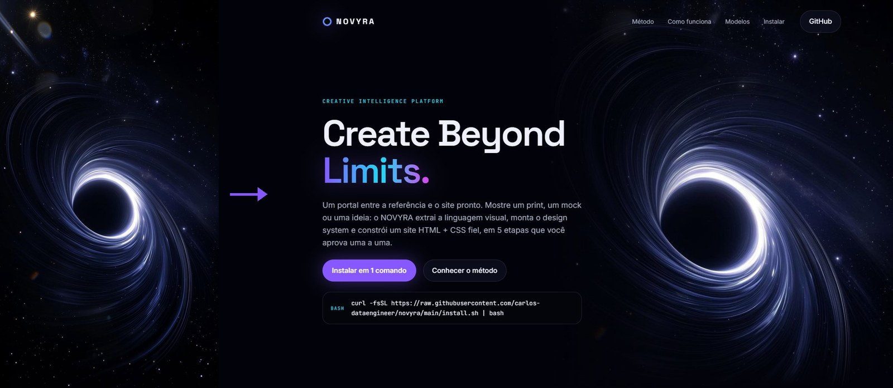

| Etapa | O que aconteceu |
|---|---|
| 1. Wireframe + plano | A arte não é uma tela de interface, então o plano a usou como **fundo do hero** e desenhou a interface por cima ([wireframe.txt](examples/portal-novyra/wireframe.txt)). |
| 2. Fundo | Paleta medida na arte com `amostrar_cores.py`: fundo `#010103`, índigo `#2d355d`/`#434b7a`/`#7b81af`, anel `#fbfbf8`. Comparação do fundo com a referência: **100%**. |
| 3. Componentes + fontes | Nav, hero "Create Beyond Limits", método em 5 etapas, camadas A/B/C, 4 modelos e instalação. Identidade NOVYRA (violeta `#8757FF`, ciano `#20D9F5`, magenta `#D946EF`), Space Grotesk + Inter. Sem estouro lateral em 390 px. |
| 4. Assets | Pulada: não havia ícones nem fotos além da arte. |
| 5. Revisão | No tamanho da referência: **91,4%** na página inteira (o texto do hero cobre parte da arte) e **100%** na região da arte; `validar_site.py` OK. |

<table>
<tr>
<td width="62%">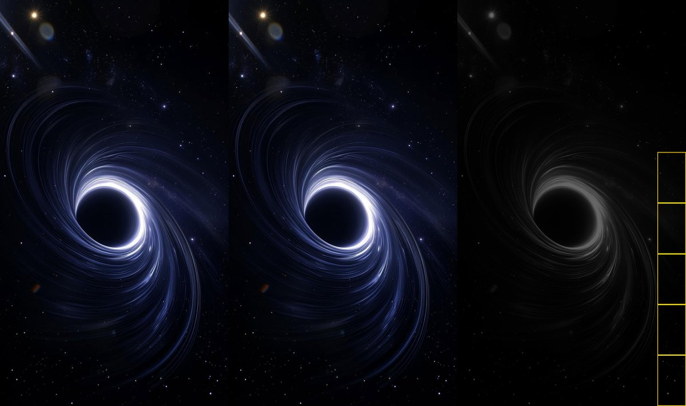<br><sub><b>Etapa 2</b>: referência | site | mapa de diferenças.</sub></td>
<td width="38%" align="center">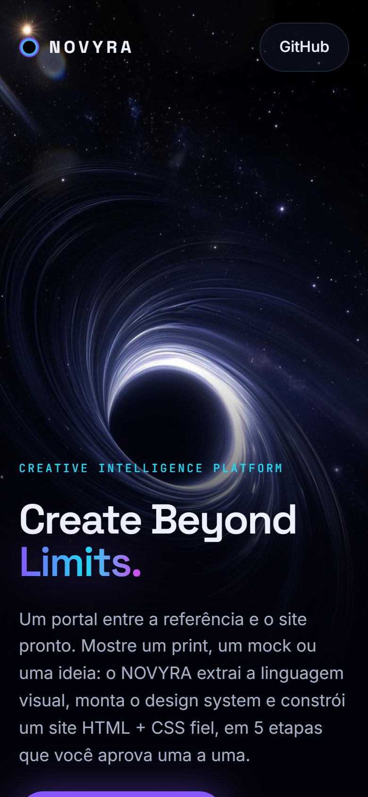<br><sub><b>Celular</b>: a arte fica atrás do hero.</sub></td>
</tr>
</table>

<details><summary><b>Página inteira</b></summary>

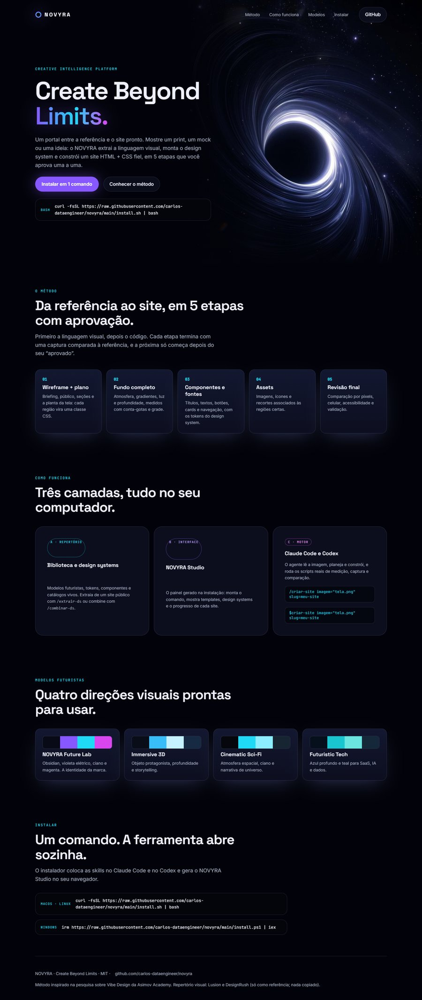

</details>

O site está em [`examples/portal-novyra`](examples/portal-novyra): abra o `index.html` no navegador.

## As 5 etapas

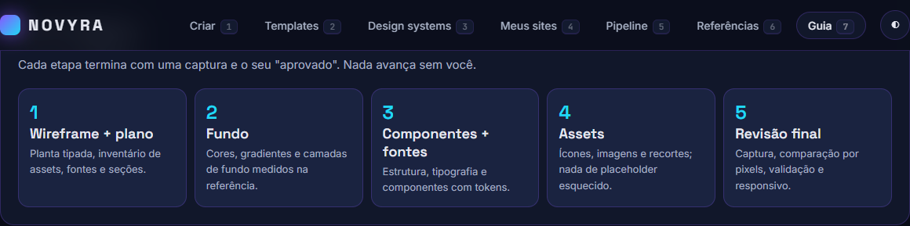

| # | Etapa | O que o agente faz | O que você aprova |
|---|---|---|---|
| 1 | **Wireframe + plano** | Planta tipada da tela (cada região vira uma classe CSS) e a técnica de cada parte | A estrutura está certa? |
| 2 | **Fundo** | Cores, gradientes e manchas medidos com conta-gotas e grade | O fundo bate com a referência? |
| 3 | **Componentes + fontes** | Estrutura, tipografia, cards, botões; compara região por região | Textos, fontes e espaçamentos |
| 4 | **Assets** | Ícones, fotos e avatares (recortes ou SVG); pulada se não houver | Os detalhes visuais |
| 5 | **Revisão final** | Captura no tamanho da referência, comparação, nota de semelhança e validação | O site pronto |

Nada avança sem o seu "aprovado". Tudo fica registrado no `ESTADO.md` do site.

## Skills e parâmetros

| Claude Code | Codex | O que faz | Parâmetros |
|---|---|---|---|
| `/criar-site` | `$criar-site` | Imagem ou briefing → site em 5 etapas | `imagem`, `brief`, `slug`, `ds`, `template` |
| `/wireframe` | `$wireframe` | Planta tipada em ASCII ou SVG (é a etapa 1) | `formato=ascii\|svg`, `imagem`, `brief`, `saida` |
| `/extrair-ds` | `$extrair-ds` | Design system de uma URL pública: tokens, componentes, catálogo | `url`, `slug` |
| `/combinar-ds` | `$combinar-ds` | Novo design system com partes de outros | `nome`, `base`, `cores`, `tipografia`, `formas`, `movimento`, `fundos` |
| `/novyra` | `$novyra` | Atualiza e abre o NOVYRA Studio | — |

As skills que mexem em arquivos só rodam quando **você** chama (não são acionadas sozinhas pelo agente).

## Templates e design systems

**Templates** (`template=`):

| | | |
|---|---|---|
| 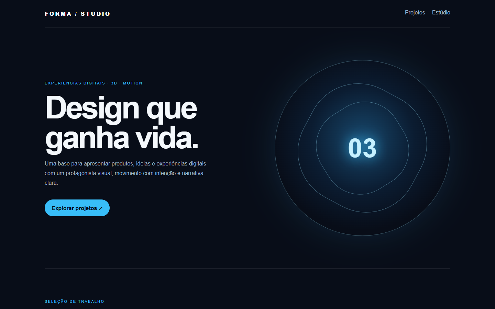 | 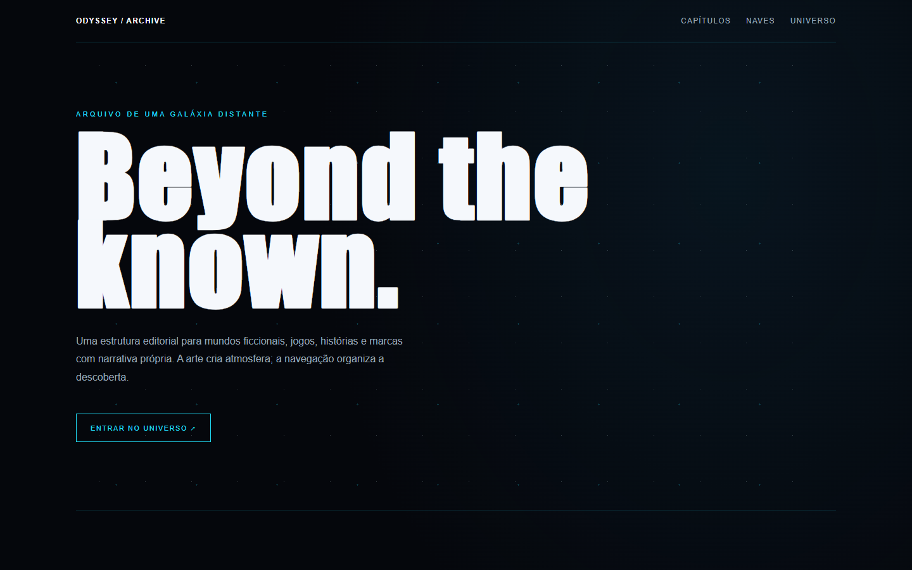 | 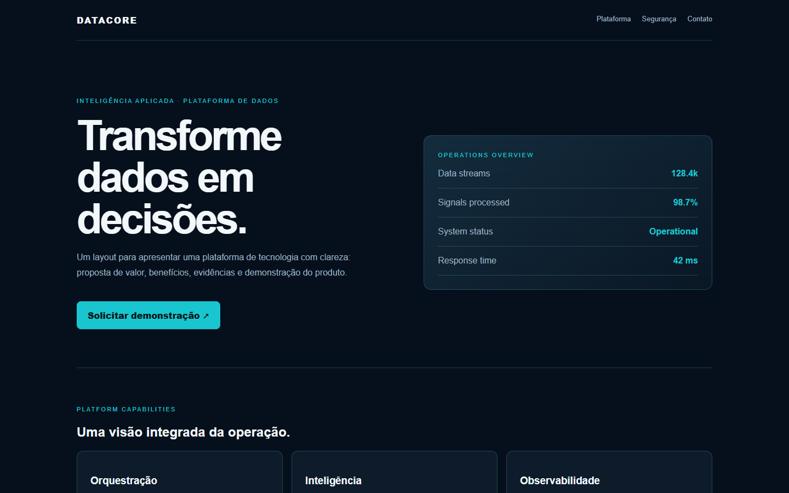 |
| `immersive-3d-studio`: portfólio com objeto protagonista | `cinematic-sci-fi`: universo sci-fi editorial | `tech-product`: produto B2B de IA e dados |
| 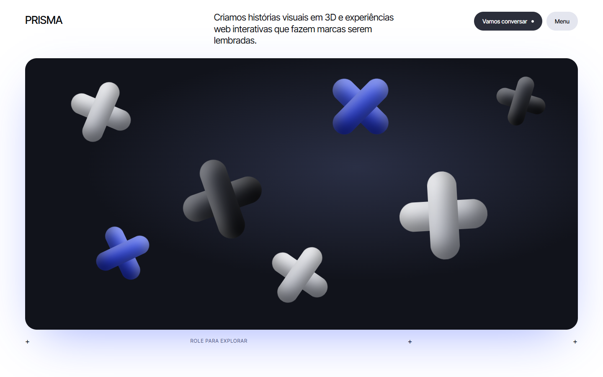 | 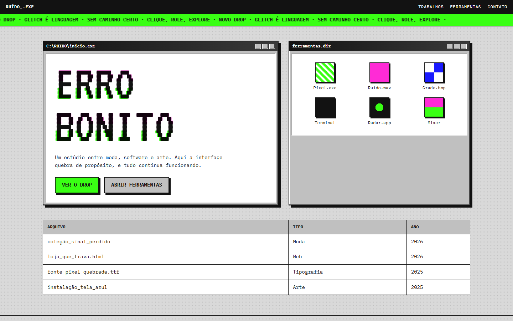 | 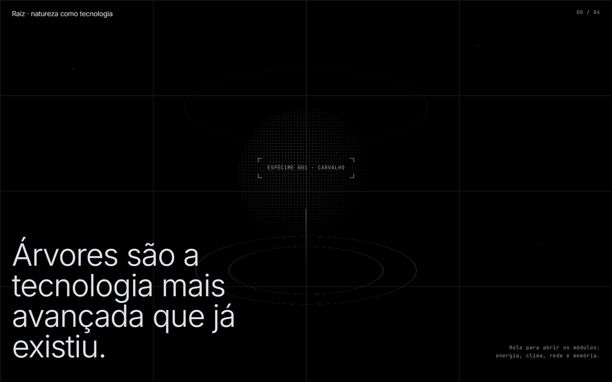 |
| `studio-3d-light`: estúdio claro com palco 3D | `retro-glitch`: janelas antigas, neon e glitch | `bio-data-mono`: natureza como dados |

E `site-base`, a base limpa (padrão) para recriar um mock pixel a pixel.

**Design systems** (`ds=`), todos autorais:

| Slug | Direção | Repertório que inspirou | Fontes |
|---|---|---|---|
| `novyra-future-lab` | Obsidian, violeta elétrico, ciano e magenta | Identidade NOVYRA | Space Grotesk / Inter |
| `studio-3d-light` | Página clara, palco 3D emoldurado, pílulas grafite | Lusion | Inter Tight |
| `cinematic-sci-fi` | Ciano espacial, títulos condensados em caixa alta | Takamo Universe | Bebas Neue / Exo 2 |
| `futuristic-tech` | Azul profundo e teal, módulos de dados | DataBahn, Moulds & More | Manrope / Inter |
| `bio-data-mono` | Preto monocromático, grade, mira e módulos | Nature Beyond Technology | Inter / JetBrains Mono |
| `retro-glitch` | Janelas antigas, verde neon, magenta, sombras duras | GLIX Studio | VT323 / IBM Plex Mono |
| `immersive-3d` | Objeto protagonista em palco escuro | Bear Classes, Alex Gurghis | Space Grotesk / Inter |

### Referências futuristas

O NOVYRA traz um catálogo com **8 referências reais**: a [Lusion](https://lusion.co/) e os 7 designs da galeria [DesignRush Futuristic](https://www.designrush.com/best-designs/websites/futuristic). Cada uma tem os padrões visuais observados e o modelo NOVYRA correspondente. Na aba **Referências** do NOVYRA Studio há três botões em cada card: copiar o `/extrair-ds` para medir o site, criar um site nessa direção ou usar o modelo.

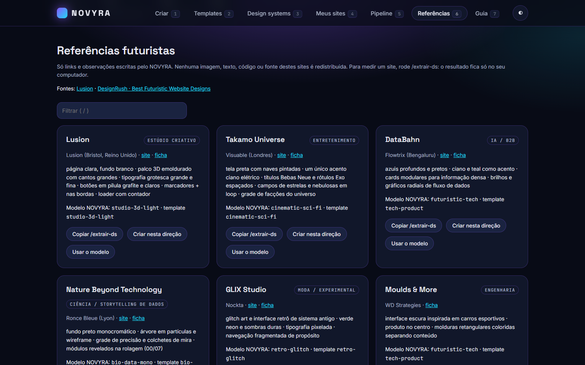

O catálogo tem só links e observações próprias: nenhuma imagem, texto ou código desses sites está no repositório. O `/extrair-ds` roda e guarda o resultado **no seu computador**. Detalhes em [docs/referencias-visuais.md](docs/referencias-visuais.md).

Cada design system tem um **catálogo vivo** (`design-system.html`) com cores e contraste, tipografia, formas, movimento e componentes nos estados padrão, hover, foco e desativado:

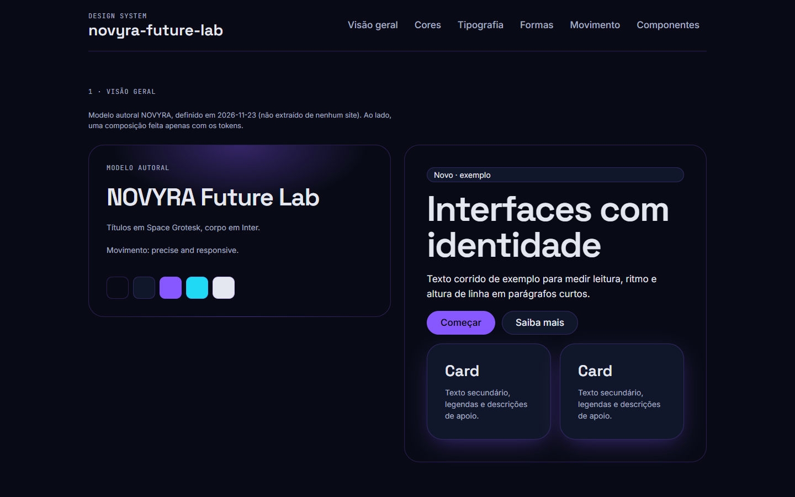

## Casos de uso

| Situação | Comando |
|---|---|
| Recriar a tela de um mock do Figma exportado em PNG | `/criar-site imagem="mock.png" slug=app-login` |
| Transformar um rascunho em papel fotografado em landing page | `/criar-site imagem="foto.jpg" slug=evento` |
| Landing de produto só com uma ideia | `/criar-site brief="..." slug=produto ds=futuristic-tech` |
| Padronizar a identidade de vários sites | `/extrair-ds` uma vez, depois `ds=` em cada `/criar-site` |
| Misturar referências (cores de uma, tipografia de outra) | `/combinar-ds nome=marca base=a cores=b tipografia=c` |
| Documentar a planta de uma tela para o time | `/wireframe formato=svg imagem="tela.png"` |
| Conferir se uma implementação ficou igual ao design | `capturar_tela.py` + `comparar.py` (nota de semelhança) |

Mais exemplos em [docs/casos-de-uso.md](docs/casos-de-uso.md).

## Atalhos

**No NOVYRA Studio:**

| Tecla | Ação |
|---|---|
| <kbd>1</kbd>–<kbd>7</kbd> | Troca de aba (Criar, Templates, Design systems, Meus sites, Pipeline, Referências, Guia) |
| <kbd>c</kbd> | Copia o comando montado |
| <kbd>a</kbd> | Alterna Claude Code / Codex |
| <kbd>/</kbd> | Foca o filtro da aba |
| <kbd>t</kbd> | Tema claro / escuro |
| <kbd>?</kbd> | Mostra os atalhos |
| <kbd>Esc</kbd> | Sai do campo de texto |

**Durante a criação (no chat com o agente):**

| Você escreve | Efeito |
|---|---|
| `aprovado` | Libera a próxima etapa |
| `ajusta o hero: o título é maior` | Corrige a etapa atual |
| `volta para a etapa 2` | Refaz a partir de uma etapa |
| `/criar-site slug=meu-site` | Retoma um site parado |

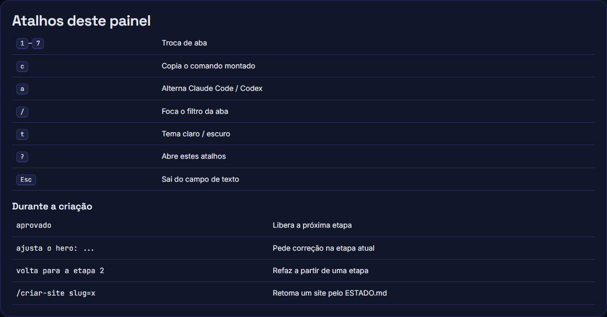

## Scripts de medição

As skills chamam por você, mas todos rodam à mão em `~/Novyra/scripts` com `python -X utf8`:

| Script | Para quê |
|---|---|
| `novo_site.py` | Cria `sites/<slug>` a partir de um template (`--imagem`, `--ds`, `--template`) |
| `recortar.py` | Grade de coordenadas, recortes e zoom da referência |
| `amostrar_cores.py` | Cor exata de pontos, paleta e gradiente de uma região |
| `capturar_tela.py` | Captura o site no Chrome headless, no tamanho da referência |
| `comparar.py` | Lado a lado, mapa de diferenças e nota de semelhança |
| `validar_site.py` | Assets faltando, caminhos, CSS/JS inline, CDNs |
| `capturar_site.py` · `extrair_tokens.py` · `gerar_ds_html.py` | Extração de design system |
| `combinar_ds.py` | Combinação de design systems |
| `gerar_painel.py` | Gera o NOVYRA Studio |
| `gerar_imagem.py` | Opcional e pago: ícones e imagens via OpenRouter (chave no `.env`) |

Como ler a nota: **≥ 95%** praticamente idêntico · **85–95%** bom, diferenças em detalhes · **< 85%** veja as piores regiões e o mapa de diferenças. Detalhes em [docs/metodologia.md](docs/metodologia.md).

## Requisitos

- **Claude Code** e/ou **Codex** (CLI, app ou extensão de IDE).
- **Python 3.10+** (no Windows, marque *Add python.exe to PATH* ao instalar).
- **Google Chrome** (ou Edge) para capturas e extração de design system.
- Windows, macOS ou Linux.

Nada roda em servidor: sem conta, sem telemetria. Só o `gerar_imagem.py` usa um serviço externo, e só se você configurar a chave.

## Perguntas frequentes

<details><summary><b>A skill não aparece depois de instalar.</b></summary>

Abra uma conversa nova. Os agentes carregam as skills no início da sessão. No Claude Code, digite `/` e procure `criar-site`; no Codex, digite `$`.
</details>

<details><summary><b>Funciona com qualquer imagem?</b></summary>

Funciona melhor com telas de interface (landing pages, dashboards, telas de app) em boa resolução, de preferência na largura de desktop (1440 px). Fotos de rascunho em papel também servem, mas a comparação por pixels passa a ser uma referência aproximada.
</details>

<details><summary><b>Posso usar o site gerado em produção?</b></summary>

Sim: é HTML + CSS puro, sem dependências. Publique em qualquer hospedagem estática. Antes, apague `reference.*` e `_capturas/` da pasta do site se a referência for confidencial, e confira a licença de imagens e fontes que vierem da referência.
</details>

<details><summary><b>Posso extrair o design system de qualquer site?</b></summary>

De páginas públicas, sem login. O NOVYRA não contorna captcha nem bloqueios. O design system extraído é para estudo e reaproveitamento de **regras** (cores, escala tipográfica, raios); não copie marcas, textos ou imagens de terceiros. A pasta `fonte/` com prints do site fica só no seu computador.
</details>

<details><summary><b>Onde ficam meus sites? E se eu reinstalar?</b></summary>

Em `~/Novyra/sites/<slug>/` (ou em `NOVYRA_SITES`). Reinstalar ou atualizar troca só os scripts e os templates e design systems do pacote; seus sites e os design systems que você criou ficam.
</details>

<details><summary><b>Já tenho uma skill chamada <code>wireframe</code>.</b></summary>

O instalador nunca apaga uma skill que não instalou: ele pula e avisa. Renomeie a sua ou rode com `--force`.
</details>

## Atualizar e desinstalar

**Atualizar:** rode o comando de instalação de novo.

**Desinstalar** (remove skills e runtime; mantém `~/Novyra/sites`):

```bash
curl -fsSL https://raw.githubusercontent.com/carlos-dataengineer/novyra/main/uninstall.sh | bash
```

```powershell
irm https://raw.githubusercontent.com/carlos-dataengineer/novyra/main/uninstall.ps1 | iex
```

## Documentação

| | |
|---|---|
| [Guia de uso](docs/guia-de-uso.md) | Passo a passo completo, opções e problemas comuns |
| [Metodologia](docs/metodologia.md) | Por que camadas, como medir e como ler a nota |
| [Arquitetura](docs/arquitetura.md) | Skills, runtime, painel e instalador |
| [Casos de uso](docs/casos-de-uso.md) | Cenários com comandos |
| [Biblioteca de modelos](docs/biblioteca-modelos-futuristas.md) | Templates e design systems e quando usar cada um |
| [Referências visuais](docs/referencias-visuais.md) | Onde buscar repertório, com cuidados de direitos |
| [Identidade da marca](docs/identidade-da-marca.md) | Cores, tipografia e conceito do NOVYRA |
| [Roadmap](docs/roadmap.md) | O que vem a seguir |

**Contribuir:** veja [CONTRIBUTING.md](CONTRIBUTING.md). Erros e ideias em [issues](https://github.com/carlos-dataengineer/novyra/issues). Segurança: [SECURITY.md](SECURITY.md).

**Créditos:** o método do NOVYRA nasceu de uma pesquisa sobre o conteúdo público da **Asimov Academy** (Vibe Design e a formação AI Designer). **Lusion** e as galerias da **DesignRush** serviram de repertório visual. Nada foi copiado; detalhes no [NOTICE](NOTICE).

**Licença:** [MIT](LICENSE). Histórico em [CHANGELOG.md](CHANGELOG.md).

<div align="center"><sub>NOVYRA · Create Beyond Limits.</sub></div>
