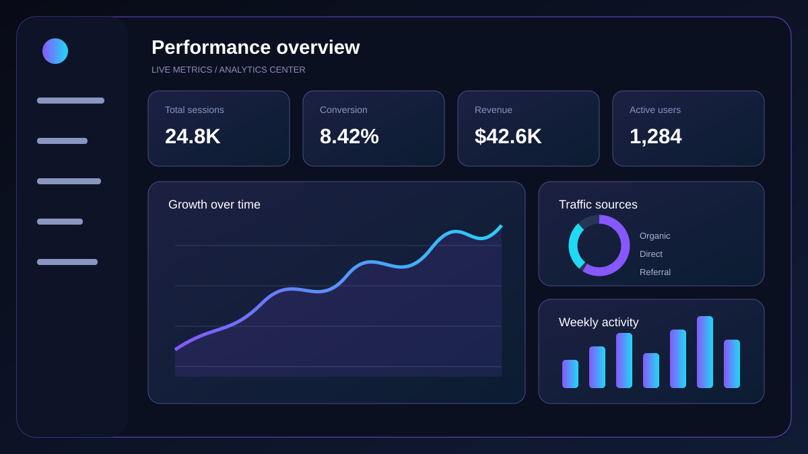
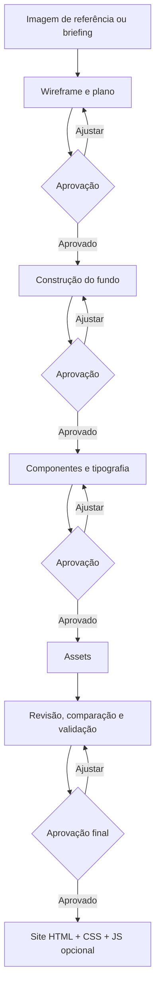
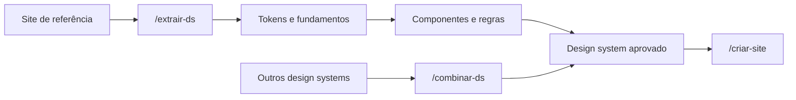

<div align="center">

# NOVYRA

### CREATE BEYOND LIMITS.

**Creative Intelligence Platform**

Uma ferramenta de criação assistida por IA, com foco especial em sites e interfaces digitais futuristas.


</div>

---

> **Estado desta publicação:** esta primeira etapa colocou no repositório a apresentação e a documentação da NOVYRA. O conteúdo executável do pacote ZIP (skills, scripts, templates e base de pesquisa) ainda não foi enviado. Portanto, este repositório ainda não deve ser tratado como um pacote instalável ou uma distribuição completa.

## Sobre o projeto

Eu criei a NOVYRA com uma ideia central: usar inteligência artificial para transformar referências, imagens e ideias em experiências digitais bem construídas, com identidade visual própria e atenção aos detalhes.

O foco principal da ferramenta é a criação de sites futuristas e interfaces com visuais marcantes, fundos elaborados, composição cuidadosa e adaptação a diferentes tamanhos de tela. Mas não quero limitar a NOVYRA a um simples gerador de páginas. A proposta é reunir métodos, skills, scripts e conhecimento especializado para apoiar diferentes atividades de criação e desenvolvimento com IA.

A primeira versão pública está sendo disponibilizada como **experimental**. Ainda preciso testar o conjunto completo em diferentes cenários, ajustar o que for necessário e evoluir a ferramenta nas próximas versões.

> **NOVYRA — Create Beyond Limits.**

## Exemplos visuais do que a NOVYRA pode criar

As imagens abaixo são **conceitos ilustrativos** criados para mostrar a direção visual que a NOVYRA busca explorar. Elas não são capturas de sites já gerados ou provas de funcionalidades executadas. São referências de resultado e inspiração para novos projetos.

### 1. Landing pages e sites futuristas


Uma página de apresentação com portal dimensional, fundo atmosférico, elementos translúcidos, chamadas de ação e composição responsiva.

### 2. Dashboards e painéis de dados



Um painel de análise com indicadores, gráficos, cartões de métricas e visualização de dados em uma interface escura com detalhes neon.

### 3. Estúdios criativos e galerias digitais


Uma interface para explorar conceitos, imagens, projetos e elementos visuais, com espaço para organizar referências e acompanhar a criação.

[Ver a galeria de exemplos](05_docs/exemplos-visuais.md)

---

## O que a NOVYRA faz nesta versão

O pacote recebido e documentado nesta versão concentra-se no Criador de Sites. Ele transforma uma imagem de referência ou um briefing em um site estático, construído em etapas e com pontos de aprovação do usuário.

- **Criar sites a partir de imagens:** usar uma captura ou mockup como referência visual.
- **Criar sites a partir de briefings:** descrever a página desejada quando não existe uma imagem de referência.
- **Planejar a interface:** gerar um wireframe tipado antes de escrever o código.
- **Construir por etapas:** separar fundo, componentes, tipografia, assets e revisão.
- **Extrair design systems:** estudar a identidade visual de um site de referência e organizar seus tokens e componentes.
- **Combinar design systems:** recombinar cores, tipografia, formas, movimento e fundos de diferentes sistemas.
- **Medir e validar:** usar scripts para capturar telas, comparar imagens e verificar a estrutura do site.

A ferramenta foi organizada para reduzir o processo de tentativa e erro. Em vez de pedir que a IA resolva tudo de uma vez, cada etapa tem um objetivo claro e pode ser revisada antes de continuar.

## Como funciona



### As cinco etapas do Criador de Sites

| Etapa | O que acontece | Skill ou ferramenta |
|---|---|---|
| 1. Wireframe e plano | A interface é dividida em regiões, componentes e técnicas de implementação | `/wireframe` |
| 2. Fundo | São construídos cores, gradientes, imagens e camadas de fundo | Scripts de medição e CSS |
| 3. Componentes e fontes | São montados estrutura, superfícies, espaçamentos e tipografia | `/criar-site` |
| 4. Assets | São preparados ícones, imagens, avatares e recortes | Scripts e geração opcional |
| 5. Revisão | O resultado é capturado, comparado e validado | `comparar.py` e `validar_site.py` |

O usuário acompanha o processo e aprova cada etapa. Se algo não estiver correto, a etapa é ajustada antes de avançar.

## Design systems: criar com direção visual

Uma das ideias que considero mais importantes é não deixar a IA escolher toda a identidade visual no improviso.

A NOVYRA oferece duas skills para trabalhar com referências:

- `/extrair-ds`: captura um site de referência, identifica fundamentos visuais e organiza tokens, componentes e regras de uso.
- `/combinar-ds`: combina grupos de características de diferentes design systems para criar uma identidade nova.



O design system define cores, tipografia, formas, movimento e componentes. Quando existe uma imagem de referência, ela orienta o layout e o conteúdo; o design system orienta a linguagem visual.

## Skills disponíveis

| Skill | Para que serve |
|---|---|
| `/criar-site` | Criar um site a partir de imagem ou briefing |
| `/wireframe` | Descrever a estrutura da interface antes do código |
| `/extrair-ds` | Extrair fundamentos e componentes de um site de referência |
| `/combinar-ds` | Combinar características de design systems |
| `/expert-asimov` | Consultar o especialista e a base de conhecimento complementar, quando instalada |

## Scripts e ferramentas

Os scripts Python apoiam o trabalho visual e técnico:

| Script | Função |
|---|---|
| `novo_site.py` | Cria a pasta de um novo site a partir do template |
| `recortar.py` | Recorta regiões e cria grades de coordenadas |
| `amostrar_cores.py` | Identifica cores, paletas e gradientes |
| `capturar_tela.py` | Captura o site em um navegador |
| `comparar.py` | Compara a captura com a imagem de referência |
| `validar_site.py` | Verifica estrutura, caminhos e referências dos arquivos |
| `capturar_site.py` | Captura um site usado como referência para design system |
| `extrair_tokens.py` | Extrai e organiza tokens visuais |
| `gerar_ds_html.py` | Gera um catálogo visual do design system |
| `combinar_ds.py` | Combina design systems |
| `gerar_imagem.py` | Gera imagens com serviço externo opcional |

## Requisitos

- Claude Code (aplicativo desktop ou terminal).
- Python 3.10 ou superior.
- Pillow.
- Microsoft Edge ou Google Chrome para capturas.
- Playwright para os fluxos de captura e extração de design system.
- Chave OpenRouter somente se você quiser utilizar a geração opcional de imagens.

Instale as dependências:

```bash
python -m pip install -r 02_criador-de-sites/requirements.txt
python -m playwright install chromium
```

> O projeto foi preparado com foco em uso no Windows. Os caminhos e comandos podem exigir ajustes em outros sistemas operacionais.

## Instalação das skills

Na pasta do projeto, execute:

```bash
python 02_criador-de-sites/01_skills/instalar_skills.py
```

Depois, reinicie a sessão do Claude Code para carregar as skills instaladas.

Consulte o [guia de instalação e uso](05_docs/guia-de-uso.md) para ver os exemplos completos.

## Exemplos de uso

Criar um site a partir de uma imagem:

```text
/criar-site imagem="C:/mocks/painel.png" slug=painel-vendas
```

Criar um site a partir de uma descrição:

```text
/criar-site brief="Landing de cafeteria com hero, cardápio em 3 cards e rodapé" slug=landing-cafe
```

Criar um site usando um design system:

```text
/criar-site brief="Landing de produto com hero e três recursos" slug=landing-produto ds=linear
```

Criar um wireframe:

```text
/wireframe formato=ascii brief="Dashboard com sidebar, quatro KPIs e tabela" saida=04_sites/dashboard/wireframe.txt
```

Extrair e combinar identidades visuais:

```text
/extrair-ds url=https://linear.app slug=linear
/combinar-ds nome=painel-noturno base=linear tipografia=stripe
```

## Estrutura do projeto

```text
novyra/
├── README.md
├── VERSION
├── CHANGELOG.md
├── 01_pesquisa/
│   └── canal-asimov-expert/
│       ├── INDICE.md
│       ├── caixas/
│       ├── videos/
│       └── aprendizados/
├── 01_skills/
│   ├── criar-site/
│   ├── wireframe/
│   ├── extrair-ds/
│   ├── combinar-ds/
│   ├── expert-asimov/
│   └── instalar_skills.py
├── 02_scripts/
├── 03_templates/
├── 04_sites/
├── 05_docs/
├── 06_Imagem/
├── 07_design_systems/
└── requirements.txt
```

A estrutura preserva `01_pesquisa/` na raiz e o Criador de Sites dentro de `02_criador-de-sites/`. Essa organização é necessária: o instalador e a skill `expert-asimov` usam caminhos relativos entre essas pastas. A pasta `04_sites/` e os materiais de referência externos ficam fora da publicação por padrão.

## Limites conhecidos desta versão

Quero deixar claro o que esta primeira publicação representa:

- A NOVYRA está em fase experimental e ainda precisa passar por testes mais amplos.
- A saída principal documentada do Criador de Sites é HTML e CSS, com JavaScript opcional; não é um construtor visual hospedado nem uma plataforma SaaS pronta.
- O uso depende do Claude Code e das skills instaladas.
- A geração de imagens via OpenRouter é opcional, externa e pode gerar custos.
- O pacote original também contém a base complementar de pesquisa em `01_pesquisa/`, com sínteses temáticas, resumos de vídeos e caderno de aprendizados. A integração operacional da skill `expert-asimov` ainda precisa ser testada no ambiente Claude Code.
- O projeto ainda não foi validado integralmente em diferentes máquinas, navegadores e cenários.

## Privacidade e segurança

- Nunca publique arquivos `.env`, chaves de API, tokens ou dados privados.
- O arquivo `.env.example` contém apenas o nome da variável esperada.
- Antes de usar geração externa, confira quais imagens e prompts serão enviados ao serviço.
- Não envie telas, dados ou materiais internos sem autorização.
- Respeite as licenças dos sites e materiais usados como referência.

## Documentação

- [Guia de instalação e uso](05_docs/guia-de-uso.md)
- [Metodologia de criação em camadas](05_docs/metodologia.md)
- [Arquitetura e componentes](05_docs/arquitetura.md)
- [Casos de uso](05_docs/casos-de-uso.md)
- [Roadmap e próximos passos](05_docs/roadmap.md)
- [Identidade da marca NOVYRA](05_docs/identidade-da-marca.md)

## Status e evolução

**Versão atual: 0.1.0 — Experimental**

A ideia é manter este mesmo repositório e evoluir o projeto por versões. Cada atualização deve registrar o que mudou, o que foi corrigido, o que foi testado e quais limitações continuam abertas.

Veja o [CHANGELOG](CHANGELOG.md) para acompanhar as mudanças.

## Créditos e referências

O método de criação em camadas foi desenvolvido a partir de estudos e adaptações de referências de criação de sites com IA. O pacote original identifica como inspiração a skill `img-to-html`, de rtadewald, no repositório [rtadewald/skills](https://github.com/rtadewald/skills).

A cópia de referência incluída no pacote local não deve ser redistribuída: o repositório de origem não declara licença. As skills deste projeto foram reescritas e adaptadas, e a pasta de referência deve permanecer fora da publicação, conforme o arquivo `.gitignore` e `ORIGEM.md`.

---

<div align="center">

**NOVYRA — CREATE BEYOND LIMITS.**

*Uma ferramenta em evolução, construída para explorar novas formas de criar com inteligência artificial.*

</div>
